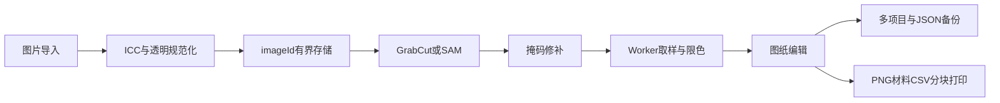

# 架构与验证

## 数据流

上传 JPG/PNG → 后端校正 EXIF 方向并将长边缩至1536以内 → 返回原色工作图 → 整图 alpha 掩码或分割掩码 → 前景裁剪与网格采样 → 色卡子集优化及映射 → 编辑 / 用量统计 → JSON 或 PNG。

选区绿色覆盖只在显示画布上绘制，取色始终使用原色图像。网格空格为 null，不计豆；白色是有效颜色，不会自动删除。

## 模块

- `backend/app.py`：20MB / 20MP 输入限制、工作图、有界多图状态、GrabCut / 可选 SAM、串行分割、静态前端服务。API 包括 GET `/api/health`、POST `/api/images`、POST `/api/segment`。
- `frontend/src/engine.ts`：采样、离散色库优化、豆数统计、少量颜色合并和全局换色预览。生成不默认使用抖动。
- `color.ts`：sRGB → Oklab 与距离计算。色相权重4会在色相与明暗/色度之间产生取舍，不应将单一指标下降视为全面改善。
- `project.ts`：v2 项目校验和旧 v1 网格兼容。项目保存源图、掩码、色表、逐格色号与设置；打开时恢复网格，不自动重新生成。
- `storage.ts`：IndexedDB 多项目目录与原子资源事务，按浏览器 origin 隔离。
- `ColorReplace.vue`：源色与目标色选择、整色替换对照；应用才创建编辑历史。锁定源色不可替换。

## 保护与边界

异步分割通过 imageId / revision 防止过期结果覆盖新选区。手工修改被新方案覆盖前需确认。预览不修改已确认图纸。撤销/重做最多20步，刷新后不恢复历史。

参考色卡全局替换同时校验来源 URL 和色号/HEX，避免演示色卡同名编号混用。换色保持网格、空格位置与总豆数，目标色已存在时实际色数会下降。锁色作用于合并和整色替换，不阻止用户单格绘制。

## 发布验证

源码发布前运行前端28项合成数据测试、TypeScript检查与Vite构建；基础后端通过隔离CPU模式的健康检查、上传与分割验证。公开目录不包括原用户图、草稿JSON、截图、实验输出、模型、虚拟环境或个人路径。

尚无轻薄本实机基准、实体拼豆校色结果或新手用户实验。照片与插画样本实验不能推导所有图像的质量。毕设后续可补充可用性实验、客观指标与实物对照。

## 毕设分支更新

多图存储更新替代上文旧版单图生命周期描述，详见api.md；IndexedDB升级为2并保留旧draft。前端GridEditor/ProjectList/PrintView与useGeneration拆分新增交互。v4默认保留，交换优化仅为候选。
