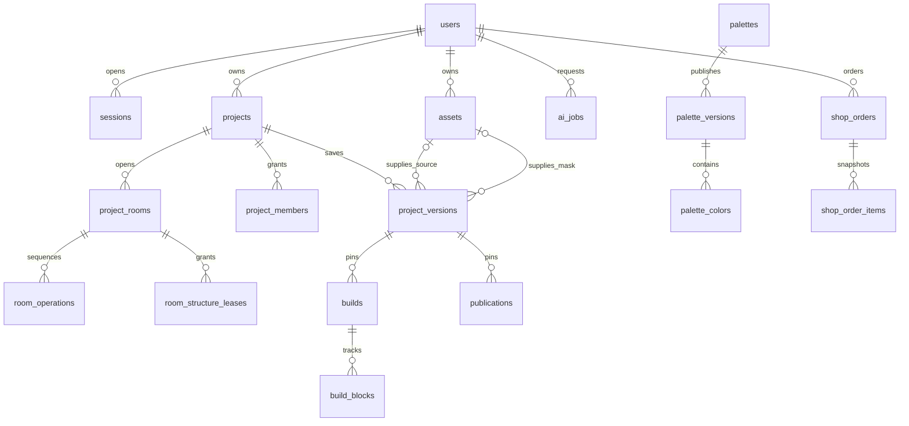

# 数据模型

## MySQL 多用户模式

按 backend/migrations/versions 的顺序迁移创建 InnoDB 表。浏览器仍保存本机草稿，账号数据使用独立的 IndexedDB 命名空间。

|实体|关系与写入约束|
|---|---|
|账号、会话、找回与关闭|users 拥有 sessions 与 account_recovery。冻结或关闭会撤销会话。|
|项目与私有资产|projects 归属用户，project_versions 以项目和序号唯一。source_id 与 mask_id 指向 PNG，接口校验所有者。|
|色卡与库存|palettes → palette_versions → palette_colors。发布版保留快照。库存流水按用户、色号和操作编号归属。|
|制作与发布|builds、publications 使用固定的 project_versions。分块按有效豆数统计，公开预览仅来自审核通过的图纸。|
|AI 与商业|ai_jobs、ai_quotas、ai_quota_events 保存预留、消耗和释放。模拟订单包含订单项、SKU 预留、支付事件和会员权益。|
|社区与协作|收藏、通知、评论和私信有独立权限。协作成员、房间和操作归属于项目。|

数据库与私有文件使用联合离线备份。账号关闭后进入保留状态。

核心外键关系如下。其余关联和具体索引以 `backend/migrations/versions` 为准。

## 既有本地模式记录
IndexedDB bead-lab升级到2，保留draft/current原始旧草稿，新增projects和resources。项目包含id、name、createdAt、updatedAt、deleted、thumbnail、project。资源以projectId:source和projectId:mask保存；保存元数据和资源在同一事务提交，不计算内容指纹。
外部JSON仍为schemaVersion2，包含源图、掩码与cells；原v1/v2解析保持兼容。不是必须升级外部版本才能增加内部项目目录。导入先校验格式、解码图像和掩码尺寸后创建新本地项目。
自动保存捕获项目id与快照，串行写入。切换前清除debounce并保存当前项目；完成反馈校验id与版本。旧草稿以legacy-draft项目复制迁移，原记录保留。删除只设置时间，可恢复。资源每项目独立，直接比较跳过不变资源写入；仍有读取比较开销。

## 2026-11-17 更新
项目导入默认新ID，原项目先保存；复制前flush最新内存。保存队列捕获调用时快照并校验反馈版本。活动ID独立记录，重命名/复制不切换活动项目；删除保留可恢复语义。资源缺失会拒绝恢复；迁移在同一IDB事务复制旧draft且保留原draft。资源直接比较跳过不变写入，不计算哈希，项目引用与资源在同一事务。thumbnail缺省时保留，显示等比适配。新可选constraints为required色号列表、源图规范化roi闭区间、weight1–4；旧cells不重算。高级无效输入只停留在UI草稿，不进入持久项目。
